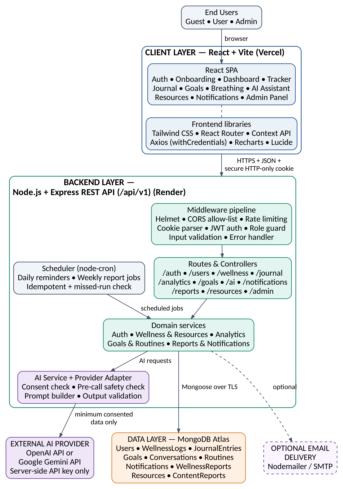
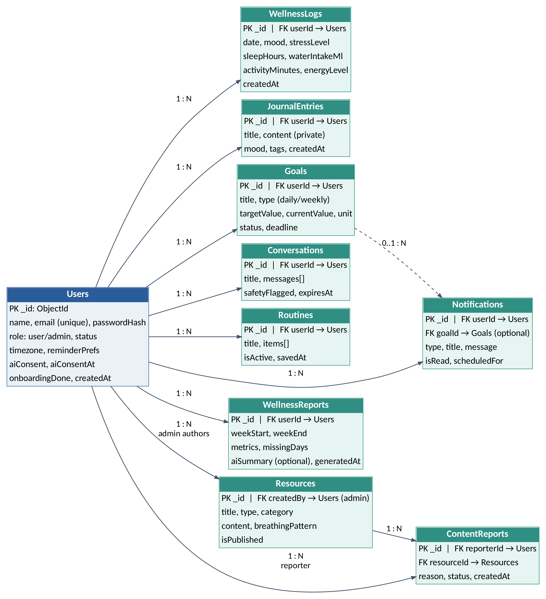
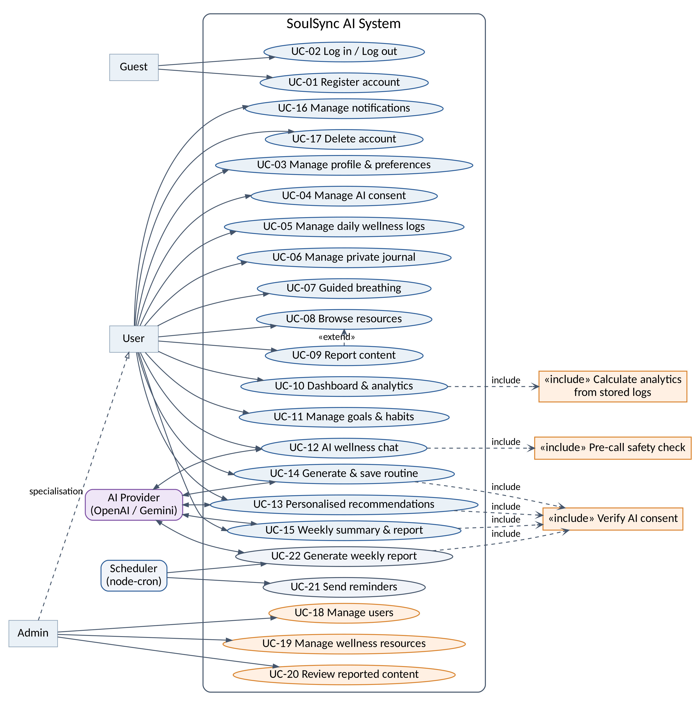
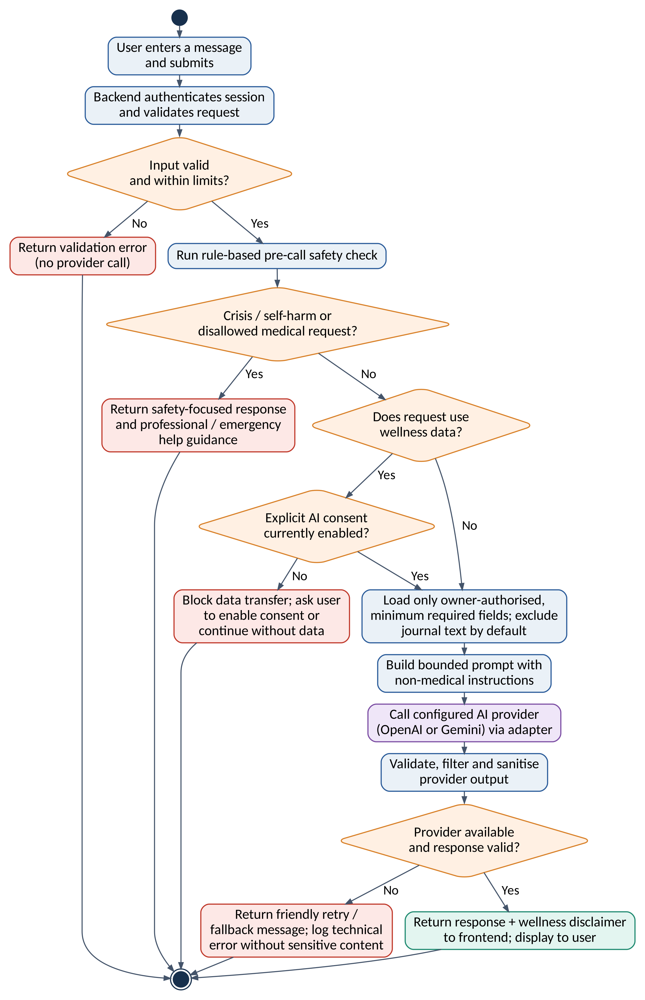

<div align="center">

# 🧠✨ SoulSync AI

**Holistic Wellness, Mental Resilience & Preventative Health Companion**

An AI-powered full-stack web application that helps users record everyday wellbeing habits, uncover patterns in their own data, and turn those insights into practical, non-medical next steps.

[](https://github.com)
[](https://github.com)
[](https://github.com)
[](https://github.com)

<p>
  <a href="#-project-overview">Overview</a> •
  <a href="#-key-features">Features</a> •
  <a href="#-technology-stack">Tech Stack</a> •
  <a href="#-system-architecture">Architecture</a> •
  <a href="#-database-design">Database</a> •
  <a href="#-api-design">API</a> •
  <a href="#-ai-integration-workflow">AI Workflow</a> •
  <a href="#-getting-started">Getting Started</a> •
  <a href="#-team-information">Team</a>
</p>

</div>

---

> [!WARNING]
> **Medical Disclaimer:** SoulSync AI is a wellness-awareness and habit-support tool. It is **not a medical device** and does not diagnose conditions, prescribe treatment, or replace doctors, counsellors, or other qualified professionals. AI-generated suggestions are general wellness guidance and are not clinically validated. If you need help with a medical or mental-health concern, please contact a qualified professional or local emergency services.

---

## 🎓 Academic Context

* **Course:** CSE 4104 – Software Development III
* **Section & Team:** Section `7A` | Team `CSE4104-7A-T03`
* **Department:** Computer Science and Engineering, Northern University of Business and Technology, Khulna
* **Submitted to:** Md. Riaz Mahmud, Assistant Professor
* **Current deliverable:** Week 04 – System Design and Software Architecture ([read the full document](docs/CSE4104-7A-T03_SystemDesign.pdf))

---

## 📖 Project Overview

University students and young professionals frequently experience irregular sleep, high stress, physical inactivity, and skipped meals. Existing health data is often scattered across multiple apps and notebooks, while most standard trackers merely display logs without offering actionable guidance.

**SoulSync AI** bridges this gap through a continuous five-stage wellness cycle:

```
  📝 Track   ──▶   📊 Understand   ──▶   ⚡ Act   ──▶   🔍 Review   ──▶   🌱 Improve
```

Users log daily wellness metrics, view trends calculated strictly from their own stored records, receive consent-based AI suggestions and daily routines, and review automated weekly progress reports. **All numerical statistics are deterministically computed by the application**—the AI is utilized solely to explain patterns and draft personalized wellness suggestions.

### 🎯 Core Objectives
1. **Secure Architecture:** Build a full-stack web application featuring authentication, profile management, and role-based access control (RBAC).
2. **Unified Tracking:** Centralize daily logs for mood, stress, sleep, hydration, physical activity, and energy levels.
3. **Data-Driven Analytics:** Render weekly and monthly charts and statistics derived from actual user records.
4. **AI Wellness Guidance:** Provide consent-driven wellness chat, tailored recommendations, daily routines, and weekly summaries.
5. **Habit Reinforcement:** Support consistency via goal tracking, guided breathing timers, reminders, and notifications.
6. **Privacy-First Design:** Enforce data minimization, explicit consent gates for external AI calls, and strict access controls.
7. **Administrative Control:** Equip administrators with tools to manage platform users and curated wellness resources.
8. **Academic Readiness:** Deliver a thoroughly tested, well-documented, and deployed application suitable for live academic evaluation.

---

## ✨ Key Features

* 🔐 **Authentication & Profile Management** — Registration, secure login/logout, profile settings, password updates, protected routes, and `User` / `Admin` role separation.
* 📅 **Daily Wellness Tracker** — Log mood, stress, sleep, hydration, activity, and energy (enforcing one structured entry per user per day).
* 🧘 **Mental Wellness Toolkit** — Private reflection journal, daily prompts, interactive guided breathing timer, and a curated wellness resource library.
* 📈 **Dashboard & Analytics** — Today's snapshot, weekly/monthly visual trends, habit streaks, and missing-day indicators.
* 🎯 **Goals & Habit Tracking** — Configurable daily and weekly targets with real-time progress and consistency metrics.
* 🤖 **AI Wellness Assistant** — Interactive wellness chatbot, personalized recommendations, daily routine generator, and weekly summary compiler.
* 🔔 **Reminders & Notifications** — In-app reminders, goal deadline alerts, and automated weekly reports (with optional email delivery).
* 🛡️ **Admin Panel** — User account oversight, wellness resource curation, and moderation of reported content.

### 🔒 AI Safety & Privacy Highlights
> [!IMPORTANT]
> Privacy and user safety are built directly into the backend pipeline:
> * **Server-Side Execution:** The AI provider is invoked **exclusively from the backend**; API keys are never exposed to the client or version control.
> * **Explicit Consent Gate:** Wellness metrics are transmitted to the AI provider **only after explicit user consent** and stripped down to minimal required fields.
> * **Zero Journal Exposure:** **Private journal text is excluded** from AI requests by default.
> * **Pre-Flight Crisis Detection:** A rule-based safety filter screens every prompt prior to AI execution; crisis indicators immediately trigger a supportive response with professional and emergency helpline resources.
> * **Output Guardrails:** All AI responses undergo validation, filtering, and mandatory non-medical disclaimer tagging.

---

## 🧰 Technology Stack

| Layer | Technologies |
| :--- | :--- |
| **Frontend** |    React Router, Axios, Context API, Recharts, Lucide React |
| **Backend** |   REST API (`/api/v1`), Mongoose ODM |
| **Database** |  |
| **Security & Auth** | JWT (HTTP-only secure cookies), Password Hashing (`bcrypt`), RBAC Middleware, Helmet, Rate Limiting |
| **AI Integration** |  /  (Swappable backend adapter service) |
| **Automation** | `node-cron`, MongoDB-backed notifications, Nodemailer (optional email alerts) |
| **Testing** | Vitest, Supertest, React Testing Library, Playwright |
| **DevOps & Hosting** |     |

---

## 🧱 System Architecture

> [!NOTE]
> The sections from here through **Testing Strategy** summarise the Week 04 system design. They describe the **intended target design**: the project is still under active development, so not every endpoint or feature listed is implemented yet. The full write-up is in [`docs/CSE4104-7A-T03_SystemDesign.pdf`](docs/CSE4104-7A-T03_SystemDesign.pdf).

SoulSync AI is a **client–server application with a modular-monolith backend**. The browser talks to the Express REST API over HTTPS using JSON and a secure HTTP-only session cookie. The backend owns authentication, validation, authorisation, database access, scheduling and all AI-provider communication. **The AI provider never connects directly to MongoDB.**

```text
┌─────────────────────────────────────────────────────────────────────────┐
│                React + Tailwind + Recharts (Browser / Vercel)           │
└────────────────────────────────────┬────────────────────────────────────┘
                                     │ HTTPS / JSON · Secure HTTP-Only Cookie
                                     ▼
┌─────────────────────────────────────────────────────────────────────────┐
│                 Node.js + Express REST API (/api/v1 · Render)           │
│  ┌───────────────────────────────────────────────────────────────────┐  │
│  │ Middleware: Helmet · CORS · Rate Limit · JWT Auth · RBAC · Joi/Zod │  │
│  ├───────────────────────────────────────────────────────────────────┤  │
│  │ Services:   Auth · Wellness · Analytics · Goals · Reports · AI    │  │
│  └───────────────────────────────────────────────────────────────────┘  │
└──────────────┬─────────────────────┬─────────────────────┬──────────────┘
               │                     │                     │
               ▼                     ▼                     ▼
      ┌─────────────────┐   ┌─────────────────┐   ┌─────────────────┐
      │  MongoDB Atlas  │   │   AI Provider   │   │  node-cron Jobs │
      │ (via Mongoose)  │   │  (via Adapter)  │   │ (Alerts/Reports)│
      └─────────────────┘   └─────────────────┘   └─────────────────┘
```

<details>
<summary><b>📐 Detailed architecture diagram (click to expand)</b></summary>
<br>
<p align="center">
  
</p>
</details>

### Layer and component responsibilities

| Layer / component | Responsibility |
| :--- | :--- |
| **Frontend (React SPA)** | Renders responsive pages and forms, manages navigation and UI state, sends API requests with credentials, and displays charts, notifications and AI responses. Holds **no** database credentials or AI API keys. |
| **API / middleware** | Serves `/api/v1` routes; applies Helmet, CORS allow-list, rate limits, cookie parsing, JWT authentication, role checks, validation and central error handling. |
| **Controllers** | Translate HTTP requests into service calls and map results or errors into consistent HTTP responses. No complex business logic here. |
| **Domain services** | Implement authentication, wellness, journal, analytics, goals/routines, resources, AI, notifications and reporting rules. |
| **Mongoose models / repositories** | Define schemas, validation, indexes and references. Every query for private records includes the authenticated owner ID. |
| **MongoDB Atlas** | Persists accounts, wellness data, journals, goals, AI conversations, routines, notifications, reports, resources and content reports. |
| **AI service + provider adapter** | Checks consent and safety, selects minimum data, builds prompts, calls the configured provider and validates/filters the output. |
| **Scheduler (`node-cron`)** | Runs reminder and weekly-report jobs; respects user time zones, avoids duplicate notifications and checks for missed runs after a restart. |
| **Optional SMTP (Nodemailer)** | Sends configured email notifications. In-app notifications remain the core delivery mechanism, and an email failure never blocks them. |

### Main request flow

`User action in React` → `Axios request to /api/v1 with credentials` → `Express middleware validates session and request` → `Controller invokes the service` → `Service reads/writes MongoDB through Mongoose (or calls the AI service)` → `Controller returns a JSON response` → `React updates the interface`

### Deployment view

| Component | Target | Configuration notes |
| :--- | :--- | :--- |
| **Frontend** | Vercel | Build and deploy the React/Vite app; expose the backend API base URL as a public frontend environment variable. |
| **Backend** | Render | Set `NODE_ENV`, `PORT`, `CLIENT_ORIGINS`, MongoDB URI, JWT secret, AI provider/key and optional SMTP credentials as server environment variables. |
| **Database** | MongoDB Atlas | Restricted database user, TLS connection, indexes and backups appropriate to the available tier. |
| **AI provider** | OpenAI **or** Google Gemini | One provider active initially; server-side key only; application-level and provider-level usage limits. |
| **Email** *(optional)* | SMTP via Nodemailer | Credentials stay server-side; delivery failure must not break in-app notification creation. |

---

## 🍃 Database Design

SoulSync AI uses **MongoDB collections accessed through Mongoose**. MongoDB does not enforce relational foreign keys the way a relational database does, so the relationships below are logical: `ObjectId` references plus backend ownership checks. Every private, user-owned record carries a `userId`, and every request scopes its query to the **authenticated owner** (the `userId` is never taken from the browser).

<p align="center">
  
</p>

### Collections and key attributes

| Collection | Key / references | Important attributes and constraints |
| :--- | :--- | :--- |
| **Users** | PK `_id` | `name`, `email` (unique), `passwordHash`, `role` (user/admin), `status` (active/suspended), `timezone`, `reminderPrefs`, `aiConsent`, `aiConsentAt`, `onboardingDone`, `createdAt` |
| **WellnessLogs** | PK `_id`; FK `userId` → Users | `date`, `mood` (1–5), `stressLevel` (1–10), `sleepHours` (0–24), `waterIntakeMl`, `activityMinutes`, `energyLevel` (1–5), `createdAt`. **Unique compound index:** `userId` + `date` |
| **JournalEntries** | PK `_id`; FK `userId` → Users | `title`, private `content`, `mood`, `tags`, `createdAt`. Journal text is excluded from AI requests by default |
| **Goals** | PK `_id`; FK `userId` → Users | `title`, `type` (daily/weekly), `targetValue`, `currentValue`, `unit`, `status` (active/done/missed), `deadline` |
| **Conversations** | PK `_id`; FK `userId` → Users | `title`, `messages[]` (role/content/timestamp), `safetyFlagged`, `expiresAt`. Retention policy applies |
| **Routines** | PK `_id`; FK `userId` → Users | `title`, `items[]` (time/activity), `isActive`, `savedAt`. The user reviews before saving |
| **Notifications** | PK `_id`; FK `userId` → Users; optional `goalId` → Goals | `type` (reminder/goal/report/system), `title`, `message`, `isRead`, `scheduledFor` |
| **WellnessReports** | PK `_id`; FK `userId` → Users | `weekStart`, `weekEnd`, `metrics`, `missingDays`, optional `aiSummary`, `generatedAt` |
| **Resources** | PK `_id`; FK `createdBy` → Users (admin) | `title`, `type` (article/breathing), `category`, `content`, `breathingPattern`, `isPublished` |
| **ContentReports** | PK `_id`; FK `reporterId` → Users; FK `resourceId` → Resources | `reason`, `status` (open/reviewed/dismissed), `createdAt` |

### Relationships and indexes

* **Users 1 : N** WellnessLogs, JournalEntries, Goals, Conversations, Routines, Notifications and WellnessReports.
* **Users 1 : N** Resources (via `createdBy`, admin authorship) and ContentReports (via `reporterId`).
* **Resources 1 : N** ContentReports · **Goals 1 : N** Notifications (via optional `goalId`).
* Unique index on `Users.email` and a unique compound index on `WellnessLogs(userId, date)`.
* Common owner/date lookups are indexed: `{userId, createdAt}`, `{userId, weekStart}` and notifications by `{userId, isRead, scheduledFor}`.

### Data integrity and privacy rules

* Validate all numeric ranges and enum values at **both** the API and schema levels.
* Never trust a `userId` supplied by the browser; derive it from the authenticated session.
* Admins can manage platform accounts and resources but **cannot read another user's private logs, journals or AI conversations**.
* Account deletion removes the user's associated private records (UC-17) as a controlled, auditable service operation.
* Apply retention/expiry to conversation records and avoid logging sensitive journal or chat content.

---

## 🎭 Use Cases

The design keeps the SRS use-case IDs **UC-01 to UC-22** and the actors **Guest, User, Admin, AI Provider and Scheduler**. Admin is a specialisation of User: an admin can use normal user features on their *own* data but never accesses another user's private wellness records.

<p align="center">
  
</p>

| Actor | Role |
| :--- | :--- |
| **Guest** | Unregistered visitor; can register and log in. |
| **User** | Registered account; manages own profile, consent, wellness logs, journal, goals, resources, AI features, reports and notifications. |
| **Admin** | User specialisation; manages accounts and published wellness resources and reviews content reports. No access to other users' private records. |
| **AI Provider** | External OpenAI or Gemini API. Receives only backend-validated, minimum and consented data. |
| **Scheduler** | Internal `node-cron` jobs that trigger reminders and weekly report generation. |

<details>
<summary><b>📋 Use case catalogue (UC-01 – UC-22)</b></summary>

| ID | Use case | Primary actor(s) |
| :--- | :--- | :--- |
| UC-01 | Register account | Guest |
| UC-02 | Log in / Log out | Guest; User; Admin |
| UC-03 | Manage profile and reminder preferences | User |
| UC-04 | Manage AI consent | User |
| UC-05 | Manage daily wellness logs | User |
| UC-06 | Manage private journal and daily reflection | User |
| UC-07 | Use guided breathing exercise | User |
| UC-08 | Browse wellness resources | User |
| UC-09 | Report content *(extends UC-08)* | User |
| UC-10 | View dashboard and analytics | User |
| UC-11 | Manage goals and habits | User |
| UC-12 | Chat with AI wellness assistant | User; AI Provider |
| UC-13 | Get personalised recommendations | User; AI Provider |
| UC-14 | Generate and save daily routine | User; AI Provider |
| UC-15 | View weekly summary and report | User; AI Provider |
| UC-16 | View and manage notifications | User |
| UC-17 | Delete account | User |
| UC-18 | Manage users | Admin |
| UC-19 | Manage wellness resources | Admin |
| UC-20 | Review reported content | Admin |
| UC-21 | Send reminders and notifications | Scheduler |
| UC-22 | Generate weekly report | Scheduler; AI Provider |

**Important relationships:** UC-10 includes *Calculate Analytics from Stored Logs* (application logic, not AI) · UC-12 includes *Run Pre-call Safety Check* · UC-13, UC-14, UC-15 and UC-22 include *Verify AI Consent* whenever wellness data is sent to the external provider · UC-09 extends UC-08 when a user reports a resource.

</details>

---

## 🤖 AI Integration Workflow

AI is used where natural-language interpretation and personalised explanation help: **wellness chat, recommendations, routine drafts and weekly summaries**. It does **not** calculate dashboard statistics; those come from the backend's stored records, so generated text is never treated as a source of numeric truth.

The **AI Wellness Chat** (UC-12) is the main workflow because it carries the security, privacy and safety decisions:

<p align="center">
  
</p>

| Step | System activity | Decision / result |
| :-: | :--- | :--- |
| 1 | User submits a message from the AI Assistant page. | Frontend sends an authenticated `POST`. |
| 2 | Backend verifies the session and validates input length and structure. | Invalid or over-limit input is rejected before any provider call. |
| 3 | Rule-based pre-call safety screening. | Crisis/self-harm language or diagnosis/prescription requests get a safety-focused response; normal generation is bypassed. |
| 4 | Backend decides whether the request needs personal wellness data. | General chat can proceed without wellness data. |
| 5 | If wellness data is needed, check the current AI consent flag. | Consent off → no data is transferred; the user is asked to enable consent or continue without personal context. |
| 6 | Load only the minimum owner-authorised fields. | Private journal text is excluded by default. |
| 7 | AI service builds a bounded prompt and calls the provider adapter. | API key stays in server environment variables. |
| 8 | Validate and filter the provider response. | On provider failure or invalid output, return a friendly fallback/retry message. |
| 9 | Return the response with a non-medical disclaimer. | Frontend shows it as general wellness guidance, never as diagnosis or clinical advice. |

**Alternative paths:** authentication failure → `401` · invalid input → `400` · rate limit → `429` · consent denied → wellness data blocked · safety trigger → human-help-focused response · provider outage → controlled fallback and a safe technical log.

### AI functions

| AI function | Input selected by backend | Expected output |
| :--- | :--- | :--- |
| **Wellness chatbot** | Current message and limited conversation context; personal wellness context only when explicitly consented and required. | Empathetic general wellness information and practical non-medical suggestions. |
| **Personalised recommendations** | Recent consented wellness metrics and goals; minimum necessary fields only. | Short list of relevant actions; patterns described as associations, not causes. |
| **Daily routine generator** | Goals, preferences and available time; optional consented context. | Realistic draft routine the user reviews and optionally saves. |
| **Weekly summary** | Application-calculated weekly metrics and missing-data indicators; AI summary only with consent. | Concise plain-language summary and next steps; metrics remain backend-calculated. |

### Mandatory safeguards

* **Consent:** new accounts start with AI consent **off**. The consent flag and timestamp are stored, and withdrawal takes effect immediately.
* **Data minimisation:** send only the fields the task needs; private journal text is excluded by default.
* **Server-side secrets:** AI keys live in backend environment variables, never in React code, browser bundles or GitHub.
* **Safety screening:** crisis/self-harm language, diagnosis or prescription requests, prompt injection, empty and over-long input are screened *before* any provider call. Crisis cases bypass normal generation and show professional/emergency help guidance.
* **Output control:** validate structure and length, filter unsafe or unsupported claims, and attach a clear non-medical disclaimer.
* **Availability:** handle timeouts, quota/rate limits and invalid responses with a friendly fallback; never expose raw provider errors or secrets.
* **Privacy:** do not log sensitive prompts or journal contents; apply conversation retention and account-deletion rules.

> [!NOTE]
> **AI model:** the exact model name is intentionally not hard-coded in the design. It will be recorded here and in the deployment configuration once the team has selected and tested one provider (OpenAI or Gemini).
>
> **Limitations:** suggestions are general wellness guidance, not clinically validated. The system never diagnoses illness, prescribes treatment, predicts disease or claims clinical effectiveness.

---

## 🔌 API Design

The REST API lives under **`/api/v1`**. The endpoints below are the **planned contract** for frontend/backend integration; compare them with the actual route files before relying on them, and keep naming consistent. Unless stated otherwise, protected endpoints require a valid JWT session cookie.

### Response conventions

```jsonc
// Success
{ "success": true, "data": { } }

// Error
{ "success": false, "message": "...", "errors": [] }
```

| Code | Meaning | Code | Meaning |
| :-: | :--- | :-: | :--- |
| `200` | Successful read / update | `403` | Forbidden action |
| `201` | Resource created | `404` | Resource not found |
| `204` | Success, no response body | `409` | Duplicate daily log / email |
| `400` | Validation error | `429` | Rate limit exceeded |
| `401` | Unauthenticated | `500` | Unexpected server error |

### Example: create a daily wellness log

```http
POST /api/v1/wellness/logs
Content-Type: application/json

{"date":"2026-11-23","mood":4,"stressLevel":3,"sleepHours":7.5,
 "waterIntakeMl":1800,"activityMinutes":30,"energyLevel":4}
```

```jsonc
// 201 Created
{"success":true,"data":{"id":"...","date":"2026-11-23","mood":4}}

// 409 Conflict (a log already exists for that user and date)
{"success":false,"message":"A wellness log already exists for this date."}
```

### Planned endpoint catalogue

*All paths are relative to `/api/v1`.*

<details>
<summary><b>Auth & Users</b> (9 endpoints)</summary>

| Method | Endpoint | Purpose / input | Expected output |
| :--- | :--- | :--- | :--- |
| `POST` | `/auth/register` | name, email, password | `201` · created user summary + session cookie |
| `POST` | `/auth/login` | email, password | `200` · user summary + session cookie |
| `POST` | `/auth/logout` | No body | `204` · clears session cookie |
| `GET` | `/auth/me` | Cookie session | `200` · current user and role |
| `GET` | `/users/profile` | Authenticated user | `200` · own profile only |
| `PUT` | `/users/profile` | name, timezone, preferences | `200` · updated profile |
| `PATCH` | `/users/password` | currentPassword, newPassword | `200` · confirmation |
| `PATCH` | `/users/ai-consent` | `enabled: boolean` | `200` · consent state and timestamp |
| `DELETE` | `/users/account` | Password confirmation | `204` · account and associated data deleted |

</details>

<details>
<summary><b>Wellness, Journal & Analytics</b> (10 endpoints)</summary>

| Method | Endpoint | Purpose / input | Expected output |
| :--- | :--- | :--- | :--- |
| `GET` | `/wellness/logs?from=&to=` | Date range | `200` · own wellness logs |
| `POST` | `/wellness/logs` | date, mood, stressLevel, sleepHours, waterIntakeMl, activityMinutes, energyLevel | `201` · created log; `409` if same user/date exists |
| `GET` | `/wellness/logs/:id` | Log ID | `200` · owned log |
| `PUT` | `/wellness/logs/:id` | Editable wellness fields | `200` · updated log |
| `DELETE` | `/wellness/logs/:id` | Log ID | `204` · deleted log |
| `GET` | `/journal` | Optional date/page filters | `200` · own journal entries |
| `POST` | `/journal` | title, content, mood, tags | `201` · created entry |
| `PUT` | `/journal/:id` | Updated journal fields | `200` · updated entry |
| `DELETE` | `/journal/:id` | Entry ID | `204` · deleted entry |
| `GET` | `/analytics/summary?range=week\|month` | Range | `200` · calculated averages, min/max, streaks and missing days |

</details>

<details>
<summary><b>Goals</b> (4 endpoints)</summary>

| Method | Endpoint | Purpose / input | Expected output |
| :--- | :--- | :--- | :--- |
| `GET` | `/goals` | Optional status/type filters | `200` · own goals |
| `POST` | `/goals` | title, type, targetValue, unit, deadline | `201` · created goal |
| `PUT` | `/goals/:id` | Goal fields / progress | `200` · updated goal |
| `DELETE` | `/goals/:id` | Goal ID | `204` · deleted goal |

</details>

<details>
<summary><b>AI</b> (6 endpoints)</summary>

| Method | Endpoint | Purpose / input | Expected output |
| :--- | :--- | :--- | :--- |
| `POST` | `/ai/chat` | message, optional conversationId | `200` · assistant response, safety metadata and disclaimer |
| `POST` | `/ai/recommendations` | Optional range / goal context | `200` · suggestion list; consent required for wellness context |
| `POST` | `/ai/routines` | goals, preferences, availableTime | `200` · routine draft |
| `GET` | `/ai/conversations` | Pagination | `200` · own conversations |
| `GET` | `/ai/conversations/:id` | Conversation ID | `200` · own conversation |
| `DELETE` | `/ai/conversations/:id` | Conversation ID | `204` · deleted conversation |

</details>

<details>
<summary><b>Reports & Notifications</b> (5 endpoints)</summary>

| Method | Endpoint | Purpose / input | Expected output |
| :--- | :--- | :--- | :--- |
| `GET` | `/reports/weekly` | Optional weekStart | `200` · calculated metrics and optional AI summary |
| `GET` | `/reports/:id` | Report ID | `200` · own report |
| `GET` | `/notifications` | Optional unread filter | `200` · own notifications |
| `PATCH` | `/notifications/:id/read` | Notification ID | `200` · updated read state |
| `PATCH` | `/notifications/read-all` | No body | `200` · count updated |

</details>

<details>
<summary><b>Resources</b> (3 endpoints)</summary>

| Method | Endpoint | Purpose / input | Expected output |
| :--- | :--- | :--- | :--- |
| `GET` | `/resources` | Search/category/type filters | `200` · published resources |
| `GET` | `/resources/:id` | Resource ID | `200` · published resource details |
| `POST` | `/resources/:id/report` | reason | `201` · content report created |

</details>

<details>
<summary><b>Admin</b> (9 endpoints · Admin role only)</summary>

| Method | Endpoint | Purpose / input | Expected output |
| :--- | :--- | :--- | :--- |
| `GET` | `/admin/users` | Search/status/page | `200` · non-sensitive account list |
| `PATCH` | `/admin/users/:id/status` | status: active/suspended | `200` · account status updated |
| `DELETE` | `/admin/users/:id` | Target user ID | `204` · account deleted |
| `POST` | `/admin/resources` | Resource fields | `201` · resource created |
| `PUT` | `/admin/resources/:id` | Resource fields | `200` · resource updated |
| `PATCH` | `/admin/resources/:id/publish` | `isPublished` | `200` · publish state |
| `DELETE` | `/admin/resources/:id` | Resource ID | `204` · resource deleted |
| `GET` | `/admin/content-reports` | Status/page | `200` · report queue |
| `PATCH` | `/admin/content-reports/:id` | status/action | `200` · report reviewed |

</details>

---

## 🔒 Security, Privacy and Quality

| Area | Design decision |
| :--- | :--- |
| **Authentication** | Hash passwords with a suitable algorithm; issue the JWT in a secure, HTTP-only cookie; clear it on logout; use generic login errors plus rate limits. |
| **Authorisation** | Authentication and role guards on routes; ownership checked in **every** private-data service query. The Admin role does not grant access to other users' private wellness data. |
| **Transport & secrets** | HTTPS in deployment; MongoDB URI, JWT secret, AI key and SMTP credentials live in server environment variables; `.env` files are never committed. |
| **Validation** | Validate types, required fields, ranges, enums, IDs, date ranges and maximum input sizes at API boundaries and the schema level. |
| **CORS & browser security** | Allow only configured client origins; use Helmet; configure cookie `SameSite`/`Secure` settings correctly for deployment. |
| **Rate limiting** | IP-based and per-user limits on login and AI endpoints; optional daily AI request cap. |
| **Privacy** | Explicit consent for wellness data sent to AI, data minimisation, private journal excluded by default, retention and deletion controls. |
| **Reliability** | Central error handler, provider timeout/fallback, database connection handling, structured logs without sensitive content, idempotent scheduled jobs. |

---

## 🧪 Testing Strategy

Unit tests cover services and validation, API integration tests cover auth, ownership and roles, frontend component tests cover the UI, and end-to-end tests cover registration, tracking, AI consent and admin actions.

| Test area | Key checks / expected result |
| :--- | :--- |
| **Authentication** | Valid registration works; duplicate email rejected; password stored as a hash; login sets an HTTP-only cookie; logout clears it; suspended users cannot log in. |
| **Ownership** | User A cannot read, update or delete User B's logs, journal, goals, conversations, routines, reports or notifications, even by changing an ID. |
| **Role access** | Guests cannot reach protected routes; normal users cannot call admin endpoints; Admin manages users/resources but cannot read private wellness records. |
| **Wellness tracker** | Metric ranges validated; one log per user/date (duplicate → conflict); dashboard refreshes after create/update/delete. |
| **Analytics** | Weekly/monthly metrics, missing days and streaks come from stored logs and application logic, **not** AI. |
| **AI consent** | Consent off blocks wellness-data transfer, and turning it off blocks later transfers immediately; journal text stays excluded by default. |
| **AI safety** | Crisis and diagnosis/prescription requests trigger the safe response; invalid or over-long input is rejected; prompt-injection patterns are screened. |
| **AI provider failure** | Timeout, quota or provider errors return a friendly fallback; no API key or sensitive content appears in logs or responses. |
| **Scheduler** | Reminders use the user's timezone and preferences; duplicates avoided; missed runs checked at startup; weekly report without consent still has calculated metrics. |
| **Admin content** | Published resources visible, unpublished hidden; reports appear in the queue and can be dismissed or acted on. |

---

## 📂 Repository Structure

> [!NOTE]
> *This reflects the planned modular architecture and will evolve as implementation progresses.*

```text
SoulSync-AI/
├── client/                  # React (Vite) frontend application
│   ├── src/
│   │   ├── components/      # Reusable UI components
│   │   ├── pages/           # Dashboard, Tracker, Journal, Goals, AI, Admin
│   │   ├── context/         # Auth and global app state (Context API)
│   │   ├── services/        # Axios API client modules
│   │   └── utils/           # Helper functions & formatters
│   └── tests/               # Frontend unit & component tests
├── server/                  # Node.js + Express backend API
│   ├── src/
│   │   ├── config/          # Environment, database & security configs
│   │   ├── middleware/      # Auth, role guard, validation, rate limit, error handlers
│   │   ├── models/          # Mongoose schemas (Users, WellnessLogs, Goals, etc.)
│   │   ├── routes/          # /api/v1 endpoint definitions
│   │   ├── controllers/     # Request handlers
│   │   ├── services/        # Analytics, reports, notifications & ai/ (adapter, safety, consent)
│   │   └── jobs/            # node-cron reminder & weekly report schedulers
│   └── tests/               # API integration & unit tests
├── docs/                    # Project proposal, SRS, system design & UML/ER diagrams
│   ├── CSE4104-7A-T03_SRS.pdf
│   ├── CSE4104-7A-T03_UseCaseDiagram.pdf
│   ├── CSE4104-7A-T03_ERDiagram.pdf
│   ├── CSE4104-7A-T03_ArchitectureDiagram.pdf
│   ├── CSE4104-7A-T03_SystemDesign.pdf
│   └── diagrams/            # Week 04 diagram exports (PNG)
│       └── src/             # Graphviz (.dot) sources for the diagrams
├── .env.example             # Environment variable template (no real secrets)
├── .gitignore
└── README.md
```

---

## 📑 Project Documentation

| Document | File Path |
| :--- | :--- |
| **Software Requirement Specification (SRS)** | [`docs/CSE4104-7A-T03_SRS.pdf`](docs/CSE4104-7A-T03_SRS.pdf) |
| **Use Case Diagram** (Week 03) | [`docs/CSE4104-7A-T03_UseCaseDiagram.pdf`](docs/CSE4104-7A-T03_UseCaseDiagram.pdf) |
| **Entity-Relationship (ER) Diagram** (Week 03) | [`docs/CSE4104-7A-T03_ERDiagram.pdf`](docs/CSE4104-7A-T03_ERDiagram.pdf) |
| **Initial System Architecture Diagram** (Week 03) | [`docs/CSE4104-7A-T03_ArchitectureDiagram.pdf`](docs/CSE4104-7A-T03_ArchitectureDiagram.pdf) |
| **System Design & Software Architecture** (Week 04) | [`docs/CSE4104-7A-T03_SystemDesign.pdf`](docs/CSE4104-7A-T03_SystemDesign.pdf) |

**Week 04 diagrams** (exported from the Graphviz sources in [`docs/diagrams/src/`](docs/diagrams/src/)):
[Architecture](docs/diagrams/system-architecture.png) · [ER](docs/diagrams/er-diagram.png) · [Use cases](docs/diagrams/use-case-diagram.png) · [AI chat activity](docs/diagrams/ai-chat-activity-diagram.png)

To re-render one after editing its source (requires [Graphviz](https://graphviz.org/)):

```bash
dot -Tpng -Gdpi=200 -Gbgcolor=white docs/diagrams/src/er-diagram.dot -o docs/diagrams/er-diagram.png
```

---

## 🚀 Getting Started

> [!TIP]
> *Setup steps below outline the standard local development workflow as modules are completed.*

### Prerequisites
* **Node.js** (v18+ recommended)
* **npm** or **yarn**
* **MongoDB Atlas** cluster (or local MongoDB instance)
* **OpenAI** or **Google Gemini** API key

### Local Installation

1. **Clone the repository**
   ```bash
   git clone https://github.com/zunayed67/CSE4104-7A-T03-SoulSync-AI-Holistic-Wellness-Mental-Resilience-Preventative-Health-Companion.git
   cd CSE4104-7A-T03-SoulSync-AI-Holistic-Wellness-Mental-Resilience-Preventative-Health-Companion
   ```

2. **Configure & start the Backend**
   ```bash
   cd server
   cp .env.example .env   # Fill in the variables listed below
   npm install
   npm run dev
   ```

3. **Configure & start the Frontend** *(in a new terminal)*
   ```bash
   cd client
   npm install
   npm run dev
   ```
   Point the frontend at the backend API base URL (`http://localhost:<PORT>/api/v1` locally) using a public environment variable; Vite only exposes variables prefixed with `VITE_`.

### Environment variables (server)

| Variable | Purpose |
| :--- | :--- |
| `NODE_ENV` | Runtime mode (`development` / `production`) |
| `PORT` | Port the Express API listens on |
| `CLIENT_ORIGINS` | Allowed browser origins for the CORS allow-list |
| `MONGODB_URI` | MongoDB Atlas connection string (restricted DB user, TLS) |
| `JWT_SECRET` | Secret used to sign session JWTs |
| `AI_API_KEY` | OpenAI or Gemini key (server-side only), together with the selected provider setting |
| SMTP settings *(optional)* | Nodemailer credentials for optional email notifications |

> [!CAUTION]
> **Never commit** `.env` files, API keys, database credentials, real private journal entries, or production secrets to the repository.

---

## 🔄 Team Workflow & Standards

* **Agile Iterations:** Short development sprints utilizing feature branches (`feature/<name>`), pull requests (PRs), and mandatory peer code reviews.
* **Branch Protection:** Direct pushes to `main` are restricted; all changes merge via reviewed PRs.
* **Definition of Done:** A feature is marked complete only after passing baseline tests and integrating cleanly into the shared codebase.
* **API-First Collaboration:** Early agreement on REST API contracts enables parallel frontend and backend development with clean, atomic commits.

### Implementation plan (Week 04 and onward)

| Phase | Implementation work | Primary responsibility |
| :--- | :--- | :--- |
| **1. Baseline & integration** | Confirm frontend/backend folder structure, environment variables, API base URL, CORS, cookie settings and the shared response format. | Zunayed Hossain |
| **2. Core backend** | Auth, user/profile, wellness logs, journal, goals, resources and notification models/routes, with validation and owner checks. | Promith Saha Joy |
| **3. Frontend integration** | Connect auth state, protected routes, dashboard, tracker, journal, goals, resources and notifications to the API. | Samira Islam Kanta |
| **4. AI module** | Provider adapter, prompts, consent checks, pre-call safety screening, response validation and AI endpoint tests. | Mousumi Khatun |
| **5. Testing & release** | End-to-end tests, role-boundary and privacy checks, scheduled-job checks, deployment docs and README update. | Whole team · led by the team leader |

<details>
<summary><b>⚠️ Key risks and mitigations</b></summary>

| Risk | Mitigation |
| :--- | :--- |
| AI API cost or quota limits | One provider initially, per-user/IP rate limits, a daily request cap and a friendly limit message; non-AI features keep working. |
| Provider downtime | Timeout handling, retries only where safe, fallback responses, and deterministic reports/analytics that do not depend on AI. |
| Sensitive data exposure | Enforced consent, data minimisation, owner-scoped queries, secret management and log redaction. |
| Scope growth | Prioritise *Must* requirements and the core user journey; defer optional features if the schedule tightens. |
| Scheduler duplicate jobs | Idempotent reminder/report generation with unique keys or existence checks before creating notifications. |
| Free-tier hosting limits | Externalised deployment configuration, cold-start testing, and documented local setup as a fallback. |

</details>

---

## 📊 Project Roadmap & Status

| Milestone | Status | Notes |
| :--- | :---: | :--- |
| **Project Proposal** | ✅ Completed | Submitted on 08 Nov 2026 |
| **SRS & Initial System Diagrams** | ✅ Completed | Submitted in Week 03 |
| **System Design & Software Architecture** | ✅ Completed | Week 04 · architecture, ER, use cases, AI workflow, API contract (23 Nov 2026) |
| **Full-Stack Implementation** | 🔄 In Progress | Active sprint development |
| **Testing, Deployment & Final Report** | ⏳ Planned | End-to-end QA & live hosting |

---

## 👥 Team Information

| # | Member Name | Student ID | Primary Responsibilities |
| :-: | :--- | :---: | :--- |
| **1** | **Zunayed Hossain** *(Team Leader)* | `11230321505` | QA, DevOps, project coordination, integration support & final submission |
| **2** | **Mousumi Khatun** | `11230321229` | AI integration, prompt engineering, provider service & AI safety testing |
| **3** | **Promith Saha Joy** | `11230321389` | Backend development, REST APIs, database schemas, auth & server validation |
| **4** | **Samira Islam Kanta** | `11230321317` | Frontend development, responsive UI, dashboard, forms, charts & API integration |

> *All team members actively contribute to system integration, testing, documentation, and peer code reviews.*

---

## 📜 License

This is an academic project developed for **CSE 4104 – Software Development III** at **Northern University of Business and Technology, Khulna**. All rights are reserved by Team `CSE4104-7A-T03` unless an open-source license is explicitly added later.
